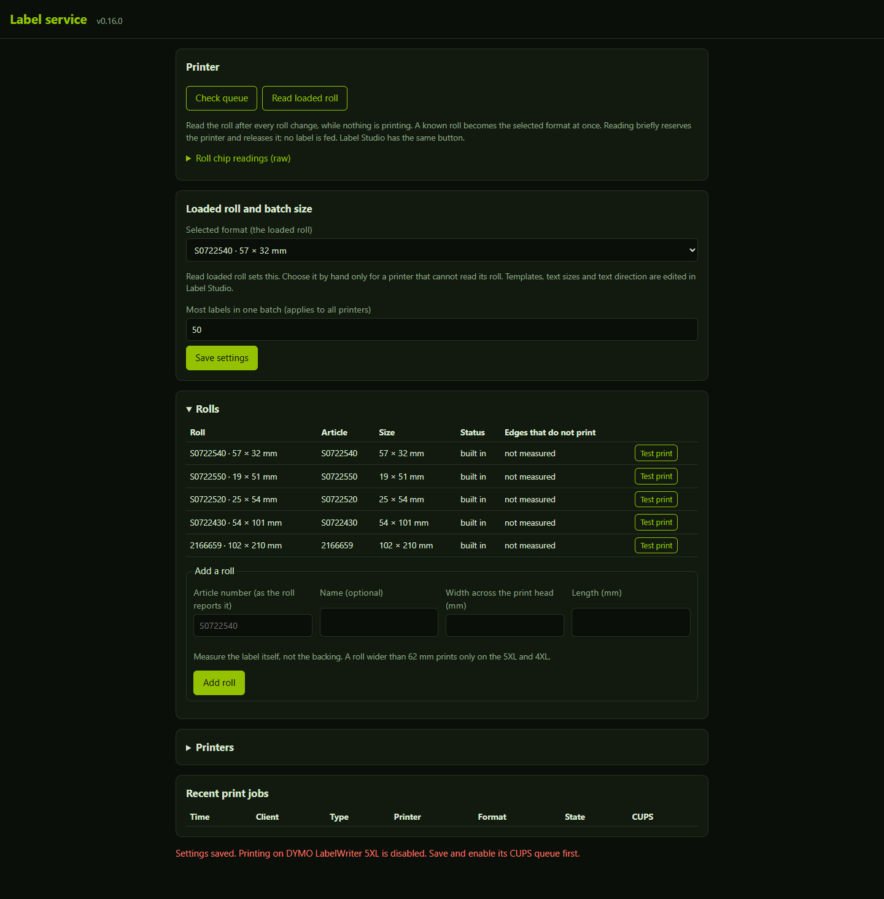
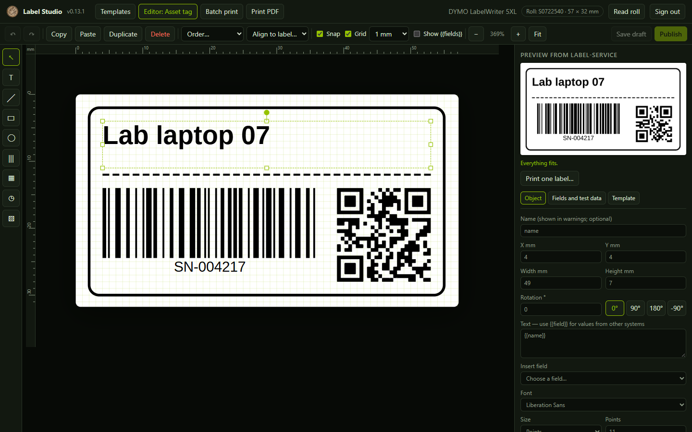

# Label service

A small LAN print service for DYMO LabelWriter printers. It is the **only** program that talks to the printers. Other systems send label content to its HTTP API; the service lays the label out from a template, shows a preview, and submits exactly one copy through CUPS. Label Studio (a separate web app) designs the templates.

Status: `VERSION` 0.16.0, in daily use with a LabelWriter 5XL together with [Label Studio](https://github.com/Snille/label-studio) 0.13.1. What changed in each version is in the [history](docs/HISTORY.md).

What it does, in short:

- Prints labels from saved templates (text, lines, boxes, barcodes, QR and Data Matrix codes, dates and pictures) or from three built-in labels (box, location, free lines).
- Renders every label as an exact preview first. Nothing that does not fit prints.
- Prints exactly one copy per request, never twice, and keeps a journal of every job.
- Prints a batch from many rows as one job, and a page of a PDF as a picture.
- Reads the roll's chip on request, so the loaded roll is known, and calibrates each roll so labels print at true size.
- Gives each calling system its own key; the admin page keeps printers, rolls and jobs.



Templates are designed in Label Studio:



The screenshots come from a local test stack with no printer.

## Why one owner

Reading the loaded roll briefly reserves the printer. Two programs that each talk to the printer can collide, and neither can stop the other. This service serializes roll reading and printing per printer, keeps one journal, and refuses to read the roll while CUPS has jobs.

## Stack

| Container | Purpose | Port |
| --- | --- | --- |
| `cups` | CUPS 2.4 on Ubuntu 24.04 with the official DYMO LW5xx driver (`raster2dymolw_v2`, built from a pinned, checksum-verified commit) for the LabelWriter 550, 550 Turbo and 5XL, and the CUPS DYMO driver (`printer-driver-dymo`) for the LabelWriter 450 and 4XL. One queue from the environment at start, plus a queue for each printer added on the admin page. | 631, stack network only |
| `api` | Node 24 HTTP API. SQLite journal, settings and templates in `/data`. `rsvg-convert` (librsvg) renders the PDF for CUPS and PNG previews. | 3230 |

CUPS sends jobs straight to the printer (`socket://PRINTER_HOST:9100`, or `PRINTER_URI` for a USB printer passed into the container). The roll reader in `api` also connects to the printer, only when an admin asks for it.

## Rendering

A label is one SVG drawing. The layout engine measures text with the real glyph metrics of the shipped fonts (`fonts/`, open licences) and draws it as outlines, so the preview, the PNG and the printed page have exactly the same shapes. The same drawing becomes the PDF that CUPS prints; a chosen text direction turns it a quarter turn onto the label. Fonts: Liberation Sans (regular, bold, italic, bold italic), Liberation Serif, Liberation Mono and DejaVu Sans Condensed (regular and bold). A character that a font lacks is refused rather than printed as a box.

Designers upload more fonts (`POST /api/v1/fonts`): a TrueType, OpenType or WOFF file, or a zip file with several, at most 8 MB. Each file is one style of a family, read from the font's own names (name IDs 1 and 2, as programs list regular, bold, italic and bold italic) and style bits; a zip adds every font it holds and names the files it skipped. WOFF2 is refused. A family may not take the name of a built-in one, and a style that is there already is refused, so delete it first to replace it. Fonts are kept in the database (schema 4) and are measured and drawn like the shipped ones. A font that a saved template uses cannot be deleted. Upload only fonts you may use; the record marks a font whose maker allows no embedding (`restricted`).

Barcodes (Code 128, Code 39, EAN-13, EAN-8, UPC-A, ITF-14) and 2D codes (QR, Data Matrix) are encoded with `bwip-js` and drawn by the layout as rectangles in whole printer dots (300 dpi): linear bars are at least two dots wide, 2D modules at least three, so codes print sharp. A box too small for that is a fit problem, not a blurred code.

Pictures (PNG, JPEG or SVG, at most 2 MB) are uploaded once and stored as PNG in the database; `rsvg-convert` turns JPEG and SVG into PNG (an SVG 1600 pixels wide) and never loads files or addresses an SVG points to. On a label the picture is resampled to whole printer dots and made black and white with a threshold or with Floyd-Steinberg dithering, so the preview shows the exact dots that print.

The npm dependencies are `opentype.js` (MIT), which reads the fonts, and `bwip-js` (MIT), which encodes the codes.

## Printers

Settings hold one CUPS server and one or more printers. Each printer has an id, a name, a model, a CUPS queue, its own loaded roll and text styles, and an optional roll reader. Jobs, roll reading and the busy lock are per printer.

| Model | Driver | Formats | Roll reading | Connection |
| --- | --- | --- | --- | --- |
| LabelWriter 5XL | LW5xx | all five | yes | network or USB |
| LabelWriter 550 Turbo | LW5xx | the four narrow formats | yes | network or USB |
| LabelWriter 550 | LW5xx | the four narrow formats | yes (network only) | USB |
| LabelWriter 450 | CUPS DYMO | the four narrow formats | no | USB |
| LabelWriter 4XL | CUPS DYMO | all five | no | USB |

The environment creates the first printer (`PRINTER_MODEL`, `CUPS_QUEUE`, `PRINTER_HOST`). More printers are added on the admin page with a name, a model and an address: `socket://host:port` on the LAN, or a `usb://` address for a USB printer passed into the cups container. Such a printer has a `device`; the api writes the list of these queues (`queue model device`, one per line) to `LABEL_QUEUES_FILE` on a volume shared with the cups container, and the cups container creates, changes and removes those queues within five seconds. It only reads that file; it never asks a printer anything. Removing a printer removes its queue and any jobs still in it, so check that the queue is empty first.

## Rolls

Step by step: [adding a new roll](docs/new-roll.md) ([på svenska](docs/new-roll.sv.md)).

The five formats below are built in. The admin page adds more (decision B11). Reading a roll that is not known yet shows Add this roll, which fills the form from the roll's chip: its article number and size (bytes 40-43 of the ESC U answer, checked on five rolls). The chip gives the whole label, so check the size with a ruler: a fold-over label such as S0722550 reports 27.9 mm across but prints on a 19 mm face. To add a roll by hand, give the article number the roll reports (`S0722540` or seven digits), an optional name, and the label size in millimetres, the width across the print head first. An added roll prints through the PPD's custom page size (`custom_40x30mm_40x30mm`), as the shipping labels do; one wider than 62 mm is offered only to the wide models.

A new roll is `testing` until its test print is approved (decision B12). While it is testing, only the admin can print its test label: a frame of straight lines, each with its outer edge 5 mm inside its edge of the label (less on very small rolls; the page names it).

### Calibration

The DYMO 5XL shrinks a print made with one of the named page sizes of DYMO's `lw5xl.ppd` (`w162h90` and the like) to about 88-92 %, the same in both directions, while the same label on a custom page size prints at true size; DYMO Connect prints true to size too. Measured with a calliper in 2026-10; CUPS and the driver do not scale. So on a printer with a 4-inch head a built-in format prints on a custom page somewhat wider than the label, drawn from its left edge: CUPS takes a custom size within a few points of a named one for the named one, so the page keeps clear of all of them (172, 90, 82 and 186 pt for the four narrow formats). The printer also puts the image a little off the label (about 0.75 mm to the right on the 57 mm roll, 1.45 mm right and 0.7 mm high on the shipping labels).

So each roll is calibrated with its test print. With a calliper, the admin measures on each side, as the preview shows the label, the distance from the label's edge to the outer edge of that side's frame line and enters the four distances:

- If they show the print shrunk (below 98 %), the roll gets a narrower image: at most as many dots as the printer printed (`maxDots`), with the label centred on a custom page that wide. Print the test label again and measure once more. (With the wider custom page this should not happen any more.)
- Otherwise the drawing is moved by the mean error of its two edges on each axis (`offset`), and the edges that do not print follow from where the page lands on paper, at least 1 mm on every side (`margins`).

Then clients see the roll and templates can use it. An object that reaches into a margin is a fit problem, like one outside the label. The built-in labels keep 3 mm at the sides or the measured edge if it is wider. The built-in formats are measured the same way: their test print and approval are on the same page, they keep printing meanwhile, and their calibration is saved in the settings (`measured`). Before a roll's margins are saved, the admin page lists the templates, built-in ones included, that reach into them and would stop printing on that roll; fix those templates in Label Studio. A roll that a printer has loaded or a saved template names cannot be removed.

## Run locally (Docker Desktop)

```powershell
$env:LABEL_ADMIN_KEY = 'development-admin-key'
$env:LABEL_CLIENT_KEYS = 'storagesystem=development-storage-key'
$env:PRINTER_HOST = '<printer address>'
docker compose up -d --build
```

The API listens on `127.0.0.1:3230`. The development keys above are for local use only. Without `PRINTER_HOST`, CUPS starts without a queue. Do not run a development stack against a printer that a live service also uses.

## Configuration

| Variable | Meaning |
| --- | --- |
| `LABEL_ADMIN_KEY` | Admin key: settings, roll reading, all jobs, templates. Also acts as client `admin` with the designer role. |
| `LABEL_CLIENT_KEYS` | `name=key,name2=key2`. One key per calling system, at least 16 characters, lower-case names. |
| `LABEL_CLIENT_ROLES` | `name=designer,name2=drafter`. Designers (Label Studio) create, publish and test-print templates; drafters (an MCP tool) only save drafts. Others are plain clients. |
| `LABEL_ALLOWED_ORIGINS` | Comma-separated browser origins allowed to call the API. Empty means server-to-server only. |
| `PRINTER_MODEL`, `PRINTER_NAME` | The first printer's model (`lw5xl`, `lw550t`, `lw550`, `lw450`, `lw4xl`) and display name. |
| `PRINTER_HOST`, `PRINTER_PORT` | The first printer on the LAN (port 9100). |
| `PRINTER_URI` | CUPS only: a device URI instead of `PRINTER_HOST`, for example a USB printer. |
| `CUPS_QUEUE` | Queue name, default `DYMO_5XL`. |
| `LABEL_DB` | SQLite file, `/data/label-service.sqlite` in Docker. |
| `LABEL_QUEUES_FILE` | Where the api writes the queues of printers added on the admin page, `/queues/queues.txt` in the stack files (a volume shared with the cups container, which reads the same path). Without it, such printers are refused. |
| `RSVG_CONVERT` | Path to `rsvg-convert`, if it is not on `PATH`. |
| `TZ` | Time zone for date objects, `Europe/Stockholm` in the stack files. |

The environment sets the first settings. After an admin saves settings through the API, the saved settings apply. Settings saved by 0.4 become the default printer on first read.

## Admin page

Open the service in a browser and enter the admin key. The page shows the CUPS queue of the chosen printer, reads the loaded roll (a known roll becomes the selected format at once) and shows the newest reading with the chip's raw answers, sets the selected format by hand for a printer that cannot read its roll, sets the batch limit, adds and removes rolls and prints and approves their test prints, adds and removes printers, and lists the newest five jobs (all on request). Rolls and Printers are folded until opened. Templates, the built-in labels included, are edited in Label Studio. The text sizes and directions saved per format before 0.16 stay in the settings: the built-in labels use them through `$titleSize` and the other format sizes. The key stays in the tab's memory only.

## API

Send the key as `x-api-key: <key>` or `Authorization: Bearer <key>`. Bodies are JSON (max 256 KB; 3 MB for a picture upload). `?printer=<id>` picks a printer where noted; without it the default printer applies.

| Method and path | Who | Purpose |
| --- | --- | --- |
| `GET /healthz` | anyone | Liveness and version. |
| `GET /api/v1/formats[?printer=]` | client | The printer's selected format (the loaded roll), its text style, the formats its model supports, the printers, the font families with their styles (`regular`, `bold`, `italic`, `boldItalic`; uploaded ones also `files`, the font id of each style) and `batchLimit` (most labels a client should send in one batch). |
| `GET /api/v1/status[?printer=]` | client | CUPS queue state from IPP attributes. Never contacts the printer. |
| `GET /api/v1/templates` | client | Built-in kinds and saved templates (published ones; designers and drafters also see the latest draft, `archived` when every version is archived and `everPublished`). |
| `GET /api/v1/templates/<id>[?version=n]` | client | One template with its definition. Plain clients see published versions only. |
| `GET /api/v1/templates/<id>/versions` | designer, drafter | All versions with their status. |
| `POST /api/v1/templates` | designer, drafter | `{definition}` → a new draft version (1, 2, ...). |
| `POST /api/v1/templates/<id>/versions/<n>/publish`, `.../archive` | designer | Publish or archive one version. |
| `DELETE /api/v1/templates/<id>` | designer | Delete every version of a template that was never published or whose every version is archived (409 otherwise: archive every version first). This frees the pictures and fonts it used; the job journal keeps its id and version. |
| `GET /api/v1/assets`, `POST /api/v1/assets` | designer, drafter | List pictures; upload `{name, data, page?, crop?}` with the picture as base64 → `{id, name, type, width, height, bytes, createdAt, createdBy}`. PNG, JPEG, SVG, or one page of a PDF (`page`, 1 by default; drawn by poppler at up to 300 dpi, the record adds `page` and `pages`). `crop` `{x, y, w, h}`, shares from 0 to 1, keeps part of any picture. At most 2 MB. |
| `GET /api/v1/assets/<id>/content` | designer, drafter | The stored PNG. |
| `GET /api/v1/fonts`, `POST /api/v1/fonts` | designer, drafter (list) / designer (upload) | List uploaded fonts; upload `{name, data}` with a font or zip file as base64 → `{fonts: [{id, name, family, style, subfamily, format, glyphs, bytes, restricted?, createdAt, createdBy}], skipped: [{name, reason}]}`. |
| `GET /api/v1/fonts/<id>/content` | designer, drafter | The font file, for an editor that draws it. |
| `DELETE /api/v1/fonts/<id>` | designer | Delete a font that no saved template uses (409 names the templates otherwise). |
| `DELETE /api/v1/assets/<id>` | designer | Delete a picture that no saved template uses (409 names the templates otherwise). |
| `POST /api/v1/previews` | client | See below → `{token, expiresAt, kind, template?, printer, layout, svg, png?, printable, warnings}`. Nothing prints. |
| `POST /api/v1/jobs` | client | `{token, requestId}` (UUIDs) → the journal record. Prints one copy. |
| `GET /api/v1/jobs`, `GET /api/v1/jobs/<requestId>` | client (own) / admin (all) | Journal records, with live CUPS job state for one job. |
| `GET`, `PUT /api/v1/settings` | admin | `{revision, config}`: `serverUrl`, `defaultPrinter`, `batchLimit`, `rolls`, `measured` (the built-in formats' margins) and `printers`. A new roll is saved as `testing`; only the approve call makes it approved. |
| `POST /api/v1/roll` | admin, designer | `{revision?, printer?}`. Reads the loaded roll once; needs an idle, empty queue. A known roll that the printer's model takes becomes its selected format: the answer has `selected`, `fits` and the new settings `revision`. Label Studio's Read roll button calls it; nothing reads the roll on its own. |
| `GET /api/v1/roll/readings` | admin | The last 20 roll readings: printer, time, article, labels remaining and the chip's whole answers as hex (`raw.consumable` from ESC U, `raw.status` from ESC A). |
| `POST /api/v1/rolls/approve` | admin | `{revision, key, requestId, distances: {left, right, top, bottom}}`: calibrates a roll from its newest test print (a `calibration` job on that roll that reached CUPS): the distances in mm from each edge of the label to its frame line. Answers the settings view and `result`: `{shrink, scale, maxDots}` (print the test label again) or `{scale, offset, margins}`. An added roll or a built-in format. With `check: true` it saves nothing and answers `{result, affected}`, the built-in kinds and saved templates (newest version) that would reach into the new margins. |

Preview request: `{kind? | template?, version?, fields | test: true | rows, check?, printer?, mediaKey?, orientation?: 'portrait'|'landscape', reference?, include?: ['png']}`.

- `kind: "calibration"` with `test: true` is the test print of the loaded roll, for the admin only.
- `kind` is a built-in template: `box` (`title`, `description`, `location`), `location` (only `location`, printed large) or `lines` (`{lines: [{text, bold?, size?}]}`, 1-12 lines, 6-16 points, shrunk together until they fit; an empty `text` is a spacer).
- A designer may save a template with the id `box`, `location` or `lines`. It keeps that label's fields and types and is for any roll (`media: ["*"]`). Its newest published version prints for `kind` instead of the original; drafts do not. When every version is archived, the original prints again. `GET /api/v1/templates` lists such a label once, as built in, with its versions and `replaced: true` while a published version replaces it.
- `template` is a saved template id (the latest published version unless `version` is given), or, for designers and drafters, a whole unsaved definition.
- `warnings` lists what stops printing, per object: `{object, message}`, for example `"recipient" needs 4 rows, but 3 fit at 7 pt`. `layout.lines` keeps the original row list (text, centre x, baseline y, size, bold, width) for clients that draw their own preview.
- `include: ['png']` adds a 300 dpi PNG of the label (base64).
- `check: true` answers the same without a token or a print document (`{check: true, ...}`), so a batch client can check every row before printing without filling the store of open previews (at most 100). Each row then prints in a batch preview with `rows`.
- `rows: [fields, ...]` (1 to `batchLimit`) makes one print document with one page per row and one token, so a batch prints as one job and the printer runs it in one go (the DYMO driver needs about 10 seconds between jobs). The answer has `labels`, `printable` and `warnings` with the `row` number (1 is the first); one row that does not fit stops the batch. The journal record of such a job has `labels`. No `layout`, `svg` or PNG; check rows one at a time with `check: true` for that.

`orientation` sets the text direction for this one label; without it, the template's direction or the selected format's saved direction applies.

## Templates

A template places objects on the readable label. Lengths are millimetres or percentages of the label side; each axis takes two of start, end and size (`x`/`right`/`w`, `y`/`bottom`/`h`). Any object may take `rotate`, degrees clockwise (-360 to 360) about the centre of its box; text fits inside the box before it is turned, and the turned corners must stay on the label. Text uses `{{field}}` placeholders.

```json
{
  "id": "shipping-small", "name": "Shipping label small", "media": ["w154h286"], "orientation": "portrait",
  "fields": {
    "recipient": { "type": "text", "maxLength": 200, "multiline": true },
    "orderNo": { "type": "text", "pattern": "^[0-9]{6,10}$", "required": false }
  },
  "objects": [
    { "type": "rect", "x": 2, "y": 2, "right": 2, "h": 12, "stroke": 0.4, "radius": 1.5 },
    { "id": "recipient", "type": "text", "x": 4, "y": 16, "right": 4, "h": 30, "text": "{{recipient}}", "font": "Liberation Serif", "size": 12, "minSize": 7, "align": "left" },
    { "type": "line", "x": 2, "y": 48, "right": 2, "h": 0, "dash": [1, 0.5] },
    { "type": "text", "x": 4, "y": "55%", "w": "50%", "h": 6, "text": "Order {{orderNo}}", "font": "Liberation Mono", "bold": true, "size": 9 }
  ]
}
```

- `media`: the formats the template is made for, or `["*"]`. A preview on another roll is refused.
- `printDensity` (optional): `light`, `medium`, `normal` or `dark`, the DYMO driver's print density for this template.
- Print quality: a label with a picture or a barcode prints with the DYMO driver's `Graphics` quality ("Barcodes and Graphics"), others with `Text`. The preview answer shows these driver options as `driver`.
- Fields: `text` (`required`, `maxLength` up to 2000, `multiline`, `pattern`, `label`, `sample`) and `lines` (`maxItems` up to 50).
- Objects: `text` (`font`, `size` in points or a format size such as `"$titleSize"`, `minSize` to shrink to, `bold`, `italic`, `wrap`, `breakHyphens`, `align`, `valign`, `lineHeight`, `color` black or white), `stack` (free lines from a `lines` field), `line`, `rect` and `ellipse` (`stroke` in mm, `fill` none, black or white, `radius`, `dash`).
- `barcode`: `symbology` (`code128`, `code39`, `ean13`, `ean8`, `upca`, `itf14`, `qrcode`, `datamatrix`), `data` with `{{field}}` placeholders, `align` and `valign` inside the box. Linear codes fill the box width with whole-dot bars and take `humanReadable` (`below`, the default, or `none`) with `font` and `size` for the text; EAN-13, EAN-8, UPC-A and ITF-14 take their digits without the check digit (12, 7, 11, 13; it is added) or with a correct one; Code 39 takes digits, capital letters, spaces and `-.$/+%`. QR codes take `ecLevel` (`L`, `M`, `Q`, `H`). Data that the symbology cannot encode is a fit problem with the reason.
- `date`: the date and time of the preview (a print uses its preview, so at most ten minutes old) in `format` (`yyyy`, `yy`, `MM`, `dd`, `HH`, `mm`; default `yyyy-MM-dd`), with optional `prefix` and `suffix` and the text properties.
- `image`: `asset` (an uploaded picture id), `fit` (`contain`, the default, keeps the proportions; `stretch` fills the box), `mode` (`threshold`, the default, or `dither` for photos and shades), `threshold` (1-254: darker is black; default 128, or 140 for dither), `lighten` (0-100: brightens the midtones first, because a thermal dot prints larger than its share; default 15 for dither, 0 for threshold), `invert`, `align` and `valign`. Transparent parts are white. A missing picture is a fit problem.
- Built-in and published templates print for every client. Drafts and unsaved designs print only with a designer key, so an LLM tool can propose but not print a template nobody has approved.

## Rules that protect the printer and the labels

- A preview belongs to the client that made it, lives ten minutes, and can create one job. Another client cannot use or see it.
- Anything that does not fit gives `printable: false` and a warning, and printing is refused.
- If `mediaKey` is sent and differs from the printer's selected format, the preview is refused. Change the roll and the format first.
- Reusing a `requestId` returns the existing record and never prints again. A lost response after submission is recorded as `unknown` and is not retried. Check the job and the label before preparing another.
- Each printer rests 10 seconds after a job and waits for an idle, empty CUPS queue before the next job: the DYMO driver refuses a job that arrives while the printer is still finishing the previous label (`com.dymo.busy-error`). A submission that waits longer than two minutes is refused with 429, never printed later.
- CUPS accepts any media name in `Validate-Job` (it even accepts sizes that do not exist), so the service's own format list is the real guard.

Built-in formats: S0722540 (57 × 32 mm), S0722550 (19 × 51 mm), S0722520 (25 × 54 mm), S0722430 (54 × 101 mm) and shipping labels 2166659 (102 × 210 mm, a CUPS custom page size because `lw5xl.ppd` has no named size for it; wide models only). On 19 × 51 mm, a landscape box label does not fit with the default sizes; use a location label or smaller sizes. Each format keeps its own text sizes and text direction per printer (landscape along the long side, portrait across it).

## Portainer

Published images (Docker Hub, `linux/amd64`): `mrsnille/label-service` and `mrsnille/label-service-cups`, tagged with the version and `latest`. Deploy [compose.portainer.yaml](compose.portainer.yaml) as a stack (Portainer, or `docker compose` with the variables in an `.env` file); it holds `cups`, `api` and Label Studio (`studio`, port 3231, image `mrsnille/label-studio`) and uses the current release tags by default. Set these stack variables:

- `LABEL_ADMIN_KEY` and `LABEL_CLIENT_KEYS`: long random keys, one client key per calling system (for example `studio=<key>,storagesystem=<key>`). Optional `LABEL_CLIENT_ROLES`, for Label Studio `studio=designer`.
- `PRINTER_HOST`: the printer's LAN address. Optional `PRINTER_MODEL` (default `lw5xl`) and `PRINTER_NAME`.
- Optional: `LABEL_BIND`, `LABEL_PORT`, `STUDIO_BIND`, `STUDIO_PORT`, `CUPS_QUEUE`, `LABEL_ALLOWED_ORIGINS`, `TZ`, or `LABEL_API_IMAGE` / `LABEL_CUPS_IMAGE` / `LABEL_STUDIO_IMAGE` to pin a digest. Without Label Studio, remove the `studio` service.

Publish ports 3230 and 3231 on the LAN only. The service has no user accounts, only keys, and is not made for the internet. Keep the volumes on local storage. The `queues` volume (0.13.0) holds only the queue list of added printers; both images create its folder for the api user, so a new volume works whichever container starts first. To update, raise the image tags (or re-pull `latest`) and recreate the stack.

Release: bump `VERSION`, add a history entry, run the checks, then build and push both images:

```powershell
$v = Get-Content VERSION
docker buildx build --platform linux/amd64 -t mrsnille/label-service:$v -t mrsnille/label-service:latest --push .
docker buildx build --platform linux/amd64 -t mrsnille/label-service-cups:$v -t mrsnille/label-service-cups:latest --push ./cups
```

## Checks and data

```powershell
npm ci
npm run check          # syntax, tests, git whitespace
npm run audit:data     # journal, settings and template audit (LABEL_DB)
node src/cli.js backup <file>
node src/cli.js restore <backup> <new-database>
```

The Docker build runs the same tests, including the PDF and PNG conversion with `rsvg-convert` (skipped on a machine without it). Hardware checks that never print: `GET /api/v1/status`, previews, `Validate-Job`, and offline raster conversion with `cupsfilter -m application/vnd.cups-raster` inside the `cups` container. The DYMO filters need a live printer connection, so the last step can only be checked with a real print.

## Licences

label-service is under the [MIT License](LICENSE). The fonts in `fonts/` are Liberation (SIL Open Font License 1.1) and DejaVu (free licence); their licence files are next to them. The `cups` image downloads and builds DYMO's own Linux driver, which keeps its own licence. The npm dependencies `opentype.js` and `bwip-js` are MIT.
